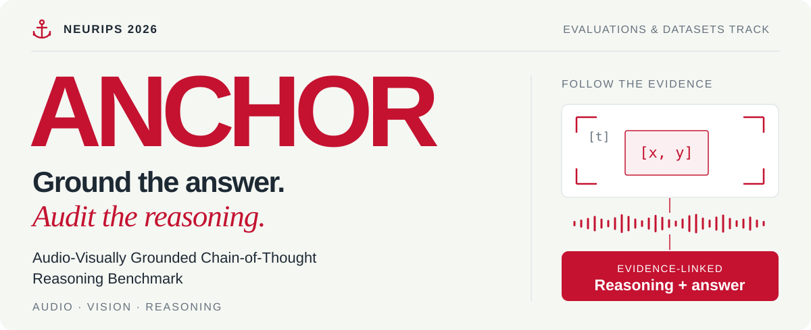
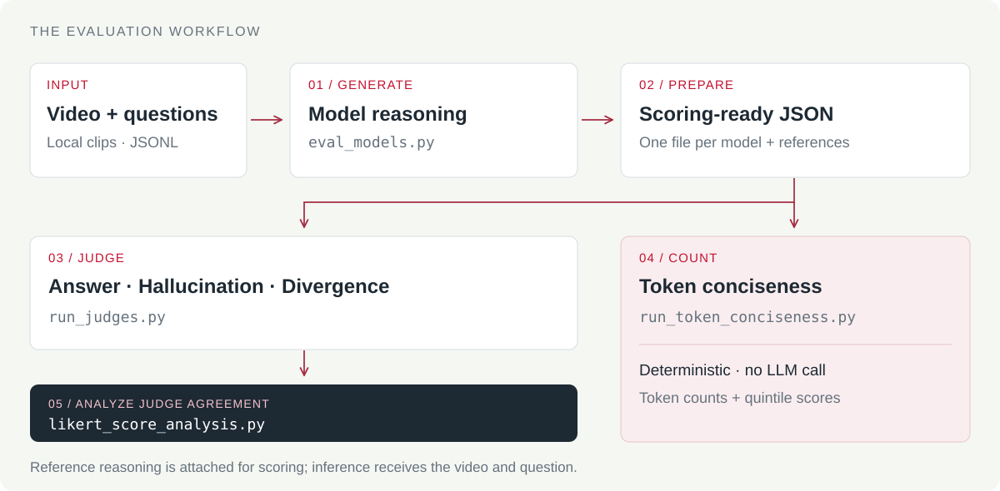

<p align="center">
  <a href="https://anchorbenchmark.github.io/">
    
  </a>
</p>

<p align="center">
  <a href="https://anchorbenchmark.github.io/"></a>
  <a href="https://anchorbenchmark.github.io/assets/ANCHOR_main_paper.pdf"></a>
  <a href="https://anchorbenchmark.github.io/assets/ANCHOR_supp.pdf"></a>
  <a href="LICENSE.txt"></a>
</p>

<p align="center">
  <a href="#01--the-benchmark">Benchmark</a> ·
  <a href="#02--from-evidence-to-evaluation">Pipeline</a> ·
  <a href="#03--get-started">Get started</a> ·
  <a href="#04--run-the-evaluation">Evaluation</a> ·
  <a href="#citation">Citation</a>
</p>

<p align="center">
  <b>Joel Julin*</b> · <b>Souraja Kundu*</b> · Liza Dahiya · George Z Wei ·<br />
  Liuyue Xie · Jingru Yi · Xu Zhang · Hao Yang · Laszlo A. Jeni<br />
  <sub>Carnegie Mellon University · Amazon AGI &nbsp; | &nbsp; * Equal contribution</sub>
</p>

## 01 / The benchmark

**Does a model really see and hear what it claims?** ANCHOR connects a model’s reasoning to the video frames, spatial regions, and sounds that support its answer. This repository provides model inference, multi-judge reasoning evaluation, deterministic conciseness scoring, and agreement analysis.

<table>
  <tr>
    <td align="center" width="25%"><h3>2,319</h3>Videos</td>
    <td align="center" width="25%"><h3>8,272</h3>Question–answer pairs</td>
    <td align="center" width="25%"><h3>207 h</h3>Audio-visual content</td>
    <td align="center" width="25%"><h3>975</h3>Human-refined QA pairs</td>
  </tr>
</table>

Nine source datasets · Seven reasoning categories · Clips from **4.9 seconds to 114.27 minutes** · Multiple-choice and open-ended questions.

### Right answer. Wrong reasons?

An answer can be correct while its explanation misses the evidence. In the paper’s lime-juice example, the reference answer is **half of an ounce**: understanding the measurement requires both the visible action and the later spoken clarification.

| **[t] When?** | **[x, y] Where?** | **[♪] What can be heard?** |
| :--- | :--- | :--- |
| Timeframes locate the relevant moment. | Bounding boxes locate objects and regions. | Speech and acoustic cues support the interpretation. |

[**Inspect the evidence example →**](https://anchorbenchmark.github.io/#grounding) &nbsp; [Browse annotated video examples →](https://anchorbenchmark.github.io/#examples)

### Four complementary evaluation facets

| Facet | What it asks | How it is scored |
| :--- | :--- | :--- |
| **Final answer** | Is the conclusion semantically correct? | Multi-judge, 1–5 Likert |
| **Hallucination** | Are the claims supported by the reference evidence? | Multi-judge, 1–5 Likert |
| **Divergence** | Does the reasoning align with the reference? | Multi-judge, 1–5 Likert |
| **Conciseness** | How much text does the response use? | Token counts and 1–5 quintile scores |

**Higher scores are better for all four facets.** A higher hallucination score means better evidence support; a higher divergence score means closer reasoning alignment. Conciseness is based on response length and should be read alongside correctness and faithfulness.

<details>
<summary><b>Dataset sources and reasoning categories</b></summary>

**Source datasets:** AVQA, Ego4D, THUMOS-14, Animal-Bench, MAVERIX, COIN, MovieChat, Video-MME, and LVBench.

**Reasoning categories:** Information Query, Sports, Gaming, Shopping, Sentiment, Egocentric Agent, and Social Interaction.

The human-refined subset covers **224 videos and 975 QA pairs**, refined by **26 participants**. See the [interactive taxonomy](https://anchorbenchmark.github.io/#taxonomy) and [paper-reported findings](https://anchorbenchmark.github.io/#findings) for dataset details and results.

</details>

## 02 / From evidence to evaluation

<p align="center">
  
</p>

| Stage | Entry point | Output |
| :--- | :--- | :--- |
| **Generate** | [`eval_models.py`](eval_models.py) | JSONL with model responses and final answers |
| **Prepare** | Regroup predictions and attach reference reasoning | One scoring JSON array per evaluated model |
| **Judge** | [`run_judges.py`](run_judges.py) | Per-judge, per-facet ratings and justifications |
| **Count** | [`run_token_conciseness.py`](run_token_conciseness.py) | Token counts, quintile scores, and plots |
| **Analyze** | [`likert_score_analysis.py`](likert_score_analysis.py) | Weighted Cohen’s κ heatmaps, distributions, and CSV summaries |

## 03 / Get started

### Install

Use **Python 3.10+** with `ffmpeg` and `ffprobe` available on your path.

```bash
git clone https://github.com/anchorbenchmark/ANCHORBenchmark.git
cd ANCHORBenchmark

python -m venv .venv
source .venv/bin/activate
python -m pip install -r requirements.txt
```

### Configure API access

The inference entry point runs **OpenAI, Anthropic, Google, and xAI models together** and checks for all four provider keys at startup.

```bash
export OPENAI_API_KEY="..."
export ANTHROPIC_API_KEY="..."
export GOOGLE_API_KEY="..."     # GEMINI_API_KEY is also accepted for inference
export XAI_API_KEY="..."
```

Model IDs are configurable through inference flags. Judge model IDs, keys, and endpoints are configured in [`JUDGE_CONFIGS`](run_judges.py).

### Prepare your data

Supply the annotation JSONL and local video files separately; this repository contains the evaluation code. Video paths in the annotations must resolve on your machine.

<details>
<summary><b>Supported inference input formats</b></summary>

Each line is a JSON object. The parser supports either of these shapes:

**Video-level questions**

```json
{"videoID": "data/videos/example.mp4", "QAs": [{"question": "What happens in the clip?", "answer": "Reference answer", "start": 0, "end": 10}]}
```

**Action annotations**

```json
{"annotation": {"video": {"src": "data/videos/example.mp4"}, "actionAnnotationList": [{"question": "What happens in the clip?", "answer": "Reference answer", "start": 0, "end": 10}]}}
```

`start` and `end` are optional segment boundaries in seconds. Reference answers are recorded with results and are not sent to the inference models.

</details>

## 04 / Run the evaluation

### 1. Generate model responses

```bash
mkdir -p results

python eval_models.py \
    --dataset data/your_dataset.jsonl \
    --output results/eval_results.jsonl \
    --use_socratic
```

`--use_socratic` enables sequential chunk processing for clips at or above `--socratic_threshold` (20 seconds by default). Chunk-level context is carried forward before the final synthesis.

<details>
<summary><b>Model selection, chunk sizes, and parallel runs</b></summary>

The defaults currently configured in the code are:

| Provider | Flag | Default model ID |
| :--- | :--- | :--- |
| OpenAI | `--chatgpt_model` | `gpt-5.2` |
| Anthropic | `--claude_model` | `claude-sonnet-4-6` |
| Google | `--gemini_model` | `gemini-3-flash-preview` |
| xAI | `--grok_model` | `grok-4-1-fast-reasoning` |

Override model IDs with these flags to use the versions available to your account.

| Option | Default | Purpose |
| :--- | :--- | :--- |
| `--socratic_interval` | `120` seconds | Chunk length for OpenAI, Anthropic, and xAI |
| `--gemini_socratic_interval` | `1800` seconds | Chunk length for Gemini |
| `--socratic_threshold` | `20` seconds | Minimum clip length for chunk processing |
| `--start_line` / `--end_line` | `1` / `-1` | Limit input dataset lines; `-1` reads through the end |
| `--shard` / `--num_shards` | `0` / `1` | Split work across independently launched processes |

For example, start separate workers with `--shard 0 --num_shards 2` and `--shard 1 --num_shards 2`. Sharded runs append `_shardN` to the output filename. Rerunning against an existing output skips video/question pairs already recorded.

</details>

### 2. Prepare the scoring inputs

Inference writes **JSONL** with a `model_answers` mapping. Both scoring scripts read **JSON arrays in `.json` files**. Regroup the predictions into one file per evaluated model, and join each response to its reference reasoning before judging.

Use names such as `scoring_inputs/chatgpt_vs_gt.json`; the `_vs_gt` suffix is required by the agreement analysis filename parser.

```json
[
  {
    "question": "What is the amount of lime juice she uses?",
    "llm_output": "The model-generated reasoning trace.\n\nFinal Answer: Half of an ounce.",
    "correct_answer": "The full reference reasoning trace.\n\nFinal Answer: Half of an ounce."
  }
]
```

This is an illustrative schema. Populate it with actual predictions and reference annotations. Keep the **full reference reasoning** in `correct_answer` for hallucination and divergence scoring; the final-answer evaluator extracts the `Final Answer:` section.

### 3. Score the reasoning with LLM judges

```bash
python run_judges.py \
    --data_path scoring_inputs/ \
    --output_dir scoring_results/ \
    --facets finalanswer hallucination divergence
```

The configured judges score each requested facet independently. Review `JUDGE_CONFIGS` for the model IDs and endpoint configuration you intend to use; `--workers` controls concurrency.

### 4. Compute token conciseness

```bash
python run_token_conciseness.py \
    --data_path scoring_inputs/ \
    --output_dir conciseness_results/
```

This stage uses `tiktoken` (`cl100k_base`) and makes **no LLM calls**. It reports raw token counts, within-model quintile scores, and pooled global quintile scores. Use the **global** scores when comparing models processed in the same run.

### 5. Analyze judge agreement

```bash
python likert_score_analysis.py \
    --base_dirs scoring_results/ \
    --output_dir analysis_results/ \
    --combined_kappa
```

Produces pairwise **weighted Cohen’s κ**, per-model score distributions, and CSV summaries. `--combined_kappa` also produces pooled agreement heatmaps across evaluated models.

<details>
<summary><b>Repository map</b></summary>

```text
ANCHORBenchmark/
├── assets/                       # README banner and pipeline illustration
├── eval_models.py                # Four-provider inference + Socratic chunking
├── run_judges.py                 # Multi-judge scoring across three facets
├── run_token_conciseness.py       # Deterministic token-based scoring
├── likert_score_analysis.py       # Judge agreement, plots, and summaries
├── src/xVerify/                  # Model wrappers, evaluators, and prompts
├── requirements.txt
└── LICENSE.txt
```

</details>

## Citation

If you use ANCHOR in your research, please cite:

```bibtex
@inproceedings{julin2026anchor,
  title={ANCHOR: Audio-Visually Grounded Chain-of-Thought Reasoning Benchmark},
  author={Julin, Joel and Kundu, Souraja and Dahiya, Liza and Wei, George Z and
          Xie, Liuyue and Yi, Jingru and Zhang, Xu and Yang, Hao and Jeni, Laszlo A.},
  booktitle={Advances in Neural Information Processing Systems},
  year={2026}
}
```

## License

Released under [CC BY-NC-ND 4.0](LICENSE.txt). See the license for attribution, noncommercial use, and redistribution terms.

<p align="center">
  <b>Keep reasoning connected to evidence.</b><br />
  <a href="https://anchorbenchmark.github.io/">Explore ANCHOR →</a>
</p>
